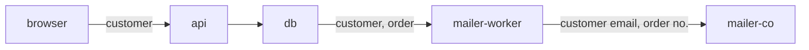

# The data register — format

The data register is a project's standing record of its data: what is held,
how sensitive it is, why it is processed, where it flows, who may touch it,
and which protections it needs against which it actually has. `data-steward`
is its only writer. Everyone else reads it: the leaders, `codebase-explorer`,
`documentalist`, `spec-writer`, and humans, including whoever answers a
regulator or an auditor. A repository has a register when
`data-register/README.md` exists at the project root.

The register serves two readers at once. Engineers need a data-centric view:
this table, this field, this flow, what does it need. The GDPR's Article 30
record of processing activities (RoPA) is purpose-centric: this purpose,
which data, whose, sent where, kept how long. The register holds both views
and links them, so neither has to be reconstructed from the other.

It describes what is true now, not what a milestone planned, so it is never
archived. Entries that stop applying are retired in place.

## Layout

```
data-register/
  README.md          marker and index: controller, scope, files, pending human decisions, external records
  classification.md  the project's sensitivity classes and the protection each requires
  inventory.md       one entry per data item: where it lives, origin, class, required vs applied protection
  processing.md      one entry per purpose: the Article 30 view
  flows.md           components and trust zones, then one entry per flow between them
  responsibilities.md  principals, grants per class, separation-of-duties rules
  processors.md      third parties that receive data (only once one exists)
```

When a file gets hard to scan (around 40 entries), split it by area into a
folder, `inventory/<area>.md`, with a `README.md` listing its files and a
one-line purpose each. Names follow `references/doc-tree-conventions.md`:
lowercase kebab-case, named by content.

## `data-register/README.md`

```markdown
# Data register

The data held and processed by <product>. Maintained by `data-steward`;
format in `~/.local/share/dev_team/references/data-register.md`.

## Controller
Controller: <organization or person, contact> | unassigned
DPO: <contact> | none designated | unassigned
Representative in the EU: <contact> | not applicable | unassigned

## Scope
Covered: <systems, repositories, environments this register describes>
Not covered: <what it deliberately leaves out, and where that is recorded>

## Files
- `classification.md` — sensitivity classes and required protection
- `inventory.md` — data items
- `processing.md` — processing purposes (Article 30 view)
- `flows.md` — components, trust zones and data flows
- `responsibilities.md` — who may do what with each class
- `processors.md` — third parties receiving data

## Pending human decisions
- `<entry-id>`: <the decision needed, in one line> (<who should decide: owner, legal, DPO, user>)

## External records
Records the register points at but does not hold.
- Impact assessments (DPIA): <location> | none yet
- Breach log: <location> | none yet
- Consent records: <location> | not applicable
- Legitimate interest assessments: <location> | not applicable
```

`Controller` and `DPO` are facts about the organization, not the code.
`data-steward` never guesses them: an unknown is `unassigned` and becomes a
pending decision. *Pending human decisions* is the register's to-do list for
humans. A line comes off when the entry it names is updated with the
decision.

## Entries, common rules

Every entry in every file except `README.md` is an H2 heading carrying its
ID, followed by `Field: value` lines. A few H2 headings are fixed sections,
not entries, and their names are reserved: `Components` and `Diagram` in
`flows.md`; `Principals`, `Grants`, `Conditions` and
`Access model cross-check` in `responsibilities.md`; `Project measures` in
`classification.md`. Grants tables sit under `Grants` as H3 headings, one
per class. A field may continue on indented lines
below it. Every field the entry's kind lists is present: an unknown value is
written `unknown` and an open decision `undecided`, never left out. A missing
field can't be told apart from one nobody considered.

### IDs

- Lowercase kebab-case, short and descriptive: `user-email`,
  `order-notifications`, `signup-to-crm`.
- Unique across the whole register, all files together.
- Never reused and never renamed. A retired ID stays in its file. Renaming
  would orphan every `@data` tag that points at it.
- Slugs never clash with the spec and UI/UX trees' numbered IDs (`D12`,
  `O4`, `Q7`). They may coincide with an intent register slug; the tag
  (`@data` vs `@intent`) keeps them apart, but prefer a distinct name.

### Status

- **`draft`**: extracted from code, inferred at preflight, or proposed.
  Nobody has confirmed it. Checks still run against it.
- **`confirmed`**: a human confirmed it. Changing its `Class`, `Purpose`,
  `Lawful basis`, `Retention`, `Owner`, or a grant in `responsibilities.md`
  needs the user's explicit agreement. `data-steward` never sets
  `confirmed` on its own initiative.
- **`retired`**: no longer applies (the field was dropped, the flow
  removed, the processor replaced). The entry stays, with a `Retired:` line
  giving why and the replacing ID if there is one. Code must not carry a
  `@data` tag for it.

### Gap and Drift

Two optional lines record a known problem without resolving it. Both stay
until the change that fixes them removes them.

- **`Gap:`** the required protection is not all applied, or a
  responsibility rule is broken. It names what is missing and the risk in
  one or two sentences. Closing a gap is implementation work for a leader;
  `data-steward` only proposes how. A gap the user decides to live with
  stays, ending in `Accepted by the user: <reason>.`, so the accepted risk
  remains visible.
- **`Drift:`** the entry and the code disagree about a fact: the code
  stores a field the entry says is not stored, sends data to a recipient
  the entry doesn't list, keeps data longer than the entry says. It names
  both sides with file and line. Which side is right is a human or leader
  call.

```markdown
Gap: Stored in plain text; class `confidential` requires `enc-field` for
  government identifiers. Exposure if the database or a backup leaks.
Drift: `src/jobs/export.py:31` sends `user-phone` to `mailer-co`; this
  entry lists no third-party recipient. Reported after task "SMS reminders".
```

`grep -rn -E '^(Gap|Drift):' data-register/` lists every open problem.

### Self-sufficiency

An entry states its facts in its own words. Links between register entries
(`Data:`, `Purposes:`, `From:`) are the register's structure and are fine.
Pointing at a spec section, decision ID or ticket as if that completed the
meaning is not. The register has to stand after those are archived or gone.

### Never copy values

The register describes data; it never contains it. No sample values from a
database, no real email addresses as examples, and never a secret's value:
a credential is recorded by name and location only (`STRIPE_SECRET_KEY`,
held in the deployment's secret store).

## `classification.md`

The project's sensitivity classes, from least to most sensitive, and the
protection each one requires. Start from the default scale and measure
catalogue in `references/data-security-baseline.md` and adapt it: a class
the project doesn't need is dropped, a measure the platform makes
impossible is replaced with its equivalent and the reason stated. Changing
a confirmed class's requirements needs the user's agreement, because it
moves every item in it.

```markdown
## confidential
Status: confirmed
Definition: Data whose disclosure would harm a person or the business,
  but which is not in a special category.
Examples: customer contact details, order history, internal pricing.
Required: tls, enc-at-rest, least-privilege, mask-in-logs, no-prod-copies,
  access-log, backup-protected, mfa-admin
Notes: Exports of more than one customer's data need `export-audit`.
```

Besides the ordered classes, two **flags** apply on top of a class and add
requirements of their own. They are defined in this file as entries too.

- `personal`: relates to an identified or identifiable person. Brings the
  item under the GDPR and into `processing.md`: every personal item must
  appear in at least one purpose.
- `special`: a special category under GDPR Article 9 (health, biometric,
  genetic, ethnic origin, political opinion, religion, union membership,
  sex life or orientation) or criminal data under Article 10. Its lawful
  basis and the need for a DPIA are always pending human decisions.

### Fields

| Field | Meaning |
|---|---|
| `Status` | `draft`, `confirmed` or `retired`. |
| `Definition` | What makes data belong here, in terms of harm if disclosed, altered or lost. |
| `Examples` | Kinds of data, from this project, never actual values. |
| `Required` | Measure IDs from the baseline catalogue (or project-defined measures, defined under *Project measures* in this file). |
| `Notes` | Conditions that add requirements in specific cases. Optional. |

## `inventory.md`

One entry per data item. **An item is an entity by default**: `customer`,
`order`, `uploaded-document`. Split out a field as its own item only when
its sensitivity, origin, retention or recipients differ from the rest of
the entity (`customer-tax-id` apart from `customer`). A field-by-field
inventory of a whole schema is never kept current; an entity-level one is.

```markdown
## customer
Status: draft
Kind: entity
Location: table `customers`; model `src/models/customer.py:Customer`
Fields: name, email, phone, postal address, created_at
Origin: entered by the customer at signup; address updated at checkout
Class: confidential, personal
Subjects: customers
Importance: high. Orders can't be fulfilled without it; losing it stops
  delivery and support.
Owner: unassigned
Retention: undecided
Regulation: GDPR
Purposes: account-management, order-fulfilment, order-notifications
Required: tls, enc-at-rest, least-privilege, mask-in-logs, no-prod-copies,
  access-log, backup-protected, mfa-admin, minimize, retention-rule,
  erasure-path, access-path
Applied: enc-at-rest (managed database default), tls, least-privilege,
  backup-protected
Gap: No retention rule and no erasure path: an erasure request can't be
  honoured and data is kept indefinitely. mask-in-logs not applied: the
  request logger writes full bodies (`src/http/log.py:18`).
```

### Fields

| Field | Meaning |
|---|---|
| `Status` | `draft`, `confirmed` or `retired`. |
| `Kind` | `entity`, `field`, `file` (uploaded or generated documents), `store` (a cache, queue, search index or analytics store holding copies), `log`, `backup`, or `secret` (credentials and keys). |
| `Location` | Where it lives: table and column, model, bucket and prefix, external system. Code locations are `path:Symbol`, not line numbers, so they survive edits; the `@data` tag is the precise link. |
| `Fields` | For an entity, the fields it holds, by name. Omitted for other kinds. |
| `Origin` | Where it comes from: entered by whom, derived from which items, received from which processor or partner, generated by the system. |
| `Class` | One class from `classification.md`, then any flags. |
| `Subjects` | Personal items only: whose data it is (customers, staff, visitors, minors). `not applicable` otherwise. |
| `Importance` | How much integrity and availability matter, and why: what breaks if it's lost or corrupted. Distinct from sensitivity. A public product catalogue is low sensitivity and high importance. |
| `Owner` | The human role accountable for its purpose, access and retention. `unassigned` until a human names one. |
| `Retention` | How long it is kept and what ends it (account closure plus 30 days, 10 years for invoices). `undecided` until an owner decides. |
| `Regulation` | Regimes that apply: GDPR, sector rules, tax-record law, contractual terms. `none identified` is a valid value. |
| `Purposes` | `processing.md` IDs. Required for every `personal` item. |
| `Required` | The measures its class and flags require, plus any the item adds. |
| `Applied` | The measures actually in place, each with its evidence: a config key, a `path:Symbol`, or the platform default it relies on. Unverified is `unknown`. |
| `Gap`, `Drift` | Optional, see above. |
| `Retired` | When retired. |

Derived copies count. A field copied into a search index, a cache, an
analytics event or a log is a `store` or `log` item of its own (or an
explicit `Applied:` line saying the copy is masked), because a deletion
that misses the copy hasn't happened.

## `processing.md`

One entry per **purpose**, named by what is done and why, never by the
tool that does it (`order-notifications`, not `sendgrid`). This is the
Article 30(1) record: the fields map one-to-one onto it, plus the lawful
basis and DPIA status that every supervisory authority's template asks for.

```markdown
## order-notifications
Status: draft
Purpose: Tell customers by email when their order is confirmed, shipped
  or refunded.
Lawful basis: undecided (contract is likely; needs the owner's decision)
Subjects: customers
Data: customer, order
Recipients: mailer-worker (internal), mailer-co (processor)
Transfers: mailer-co stores data in the United States; safeguard undecided
Retention: Messages are not stored by us; mailer-co keeps logs 30 days.
Security: tls on every hop; mailer-co receives email address and order
  number only, not the address or items.
DPIA: not needed. Ordinary contact data, expected by the customer.
Intent: order-confirmation-email
```

### Fields

| Field | Meaning |
|---|---|
| `Status` | `draft`, `confirmed` or `retired`. |
| `Purpose` | One sentence, one purpose. Two purposes joined by "and" are two entries. |
| `Lawful basis` | One of: consent, contract, legal obligation, vital interests, public task, legitimate interests. Always a human decision: `data-steward` may suggest the likely one in parentheses and records `undecided` until told. |
| `Subjects` | Categories of people. |
| `Data` | `inventory.md` IDs. Categories of personal data are read from those items. |
| `Recipients` | Components from `flows.md` and processors from `processors.md` that receive the data. |
| `Transfers` | Countries outside the EU/EEA the data reaches, and the safeguard (adequacy decision, standard contractual clauses). `none` when there are none. |
| `Retention` | How long data is kept for this purpose, if narrower than the items' own retention. |
| `Security` | A short description of the measures protecting this processing, as Article 30 asks. It summarizes the items' `Applied` lines; it never claims more. |
| `DPIA` | `not needed` with a one-line reason, `needed` with the reason (and a pending human decision), or `done` with the external record's location. |
| `Intent` | Optional, when the project has declared intent: the business entries this purpose serves. |
| `Gap`, `Drift`, `Retired` | As above. |

### Exporting to a RoPA template

A regulator or auditor wants a table, usually the CNIL's or the ICO's
template. `processing.md` maps onto it directly: one row per purpose, the
README's controller and DPO lines in the header, categories of personal
data taken from each `Data` item's `Fields` and flags, recipients named by
the processor's legal name in `processors.md`. An export is generated on
request and never stored in the register, so there is only one record to
keep current.

## `flows.md`

Two parts. The top of the file defines the **components** and the **trust
zones** they sit in. The rest is one entry per **flow**: data moving from
one component to another.

~~~markdown
# Data flows

## Components

| Component | Zone | What it is |
|---|---|---|
| `browser` | public | The customer's browser |
| `api` | backend | The HTTP API, `src/api/` |
| `db` | data | The primary database |
| `mailer-worker` | backend | Background job sending email, `src/jobs/mail.py` |
| `mailer-co` | third-party | Email processor, see `processors.md` |

Zones: public (untrusted) → backend → data; third-party is outside our
control. A flow that crosses zones is listed with the crossing.

## Diagram


~~~

Each flow entry:

```markdown
## orders-to-mailer
Status: draft
From: mailer-worker
To: mailer-co
Data: customer (email only), order (number and status only)
Trigger: an order changes status
Transport: HTTPS to the processor's API, key `MAILER_API_KEY`
Crosses: backend → third-party
Purposes: order-notifications
```

| Field | Meaning |
|---|---|
| `From`, `To` | Component names from the table. |
| `Data` | `inventory.md` IDs, narrowed in parentheses when only part of an item flows. Minimization shows here. |
| `Trigger` | What makes the data move: a request, a schedule, an event. |
| `Transport` | How it moves and how it's protected in transit; the credential by name. |
| `Crosses` | The zone boundary crossed, or `none`. A crossing is where most exposure happens, so every crossing flow gets the baseline's flow questions. |
| `Purposes` | `processing.md` IDs this flow serves. |
| `Gap`, `Drift`, `Retired` | As above. |

The table and the entries are the record. The diagram is a convenience
drawn from them; when they disagree, the entries win and the diagram is
redrawn.

## `responsibilities.md`

Who may do what with each class of data, on the **system and operator
side**: services, service accounts, jobs, CI, staff roles, administrators.
End-user permissions inside the product belong to the spec tree's access
model (`access-model.md`, owned by `spec-writer`), which deliberately leaves
infrastructure and database access out of scope. This file covers that
excluded side and records the cross-check between the two.

### Principals

| Principal | Kind | What it is | Credential |
|---|---|---|---|
| `api` | service | The HTTP API | database role `app_rw` |
| `mailer-worker` | job | Sends email | database role `app_ro`, `MAILER_API_KEY` |
| `ci` | automation | Builds and deploys | deploy token in CI secrets |
| `developer` | staff | Writes code; no production access by default | none in production |
| `operator` | staff | Runs production | cloud console with MFA |
| `end-users` | product actors | Everyone using the product | see the access model |

### Grants

One table per class (or per item, where an item needs tighter rules than
its class). Rows are operations, columns are principals, and every cell is
`allow`, `deny`, or a named condition defined under *Conditions*. No blank
cells, for the access model's reason: a blank is an operation nobody
considered. A cell may read `unknown` where the grant couldn't be
established from code and config; each such table gets a line under
*Pending human decisions* until a human settles it.

**confidential**

| Operation | `api` | `mailer-worker` | `ci` | `developer` | `operator` |
|---|---|---|---|---|---|
| `read` | allow | `mail-fields-only` | deny | deny | `break-glass` |
| `write` | allow | deny | deny | deny | `break-glass` |
| `export` | deny | deny | deny | deny | `ticketed` |
| `delete` | `erasure-request` | deny | deny | deny | `ticketed` |
| `administer` | deny | deny | deny | deny | allow |

`administer` means changing who else holds a grant: database roles, bucket
policies, key policies.

### Conditions

| Condition | Holds when |
|---|---|
| `mail-fields-only` | The query selects only email and order number |
| `break-glass` | An incident is open, access is time-boxed and logged, and a second operator is notified |
| `ticketed` | A request ticket names the reason and is approved by someone other than the requester |

### Separation of duties

Pairs of responsibilities that must not rest with the same principal, each
with the reason. Starting patterns are in the baseline.

```markdown
## audit-log-independence
Status: draft
Rule: No principal that can write `confidential` or `restricted` data can
  alter or delete the access log that records it.
Why: Otherwise access can be hidden after the fact.
Holds: no — `operator` administers both the database and its log bucket.
Gap: Move log bucket administration to a separate role, or ship logs to an
  append-only store.
```

| Field | Meaning |
|---|---|
| `Rule` | The two responsibilities that must stay apart. |
| `Why` | The abuse or mistake it prevents. |
| `Holds` | `yes`, `no` with the principal that breaks it, or `unknown`. |
| `Gap`, `Retired` | As above. |

### Access model cross-check

A short section, rewritten on each review of the access model: for every
end-user actor that can reach `confidential` or higher data, or `export`
personal data, whether the access model's matrix and its audited
operations are consistent with the class's requirements. Inconsistencies
go to the user and `spec-writer` as findings; `data-steward` never edits
the access model.

## `processors.md`

Created when the first third party receives data. One entry per company or
service.

```markdown
## mailer-co
Status: draft
Legal name: Mailer Co, Inc.
Role: processor
Receives: customer (email only), order (number and status only)
Purposes: order-notifications
Location: United States
Safeguard: undecided
Contract: unknown (is a data processing agreement signed?)
Subprocessors: unknown
```

| Field | Meaning |
|---|---|
| `Role` | `processor` (acts on our instructions), `controller` (decides its own purposes, such as a payment network), or `joint controller`. A human decision when unclear. |
| `Receives` | `inventory.md` IDs, narrowed as in flows. |
| `Purposes` | `processing.md` IDs. |
| `Location` | Where it stores or processes the data. |
| `Safeguard` | For a location outside the EU/EEA: adequacy decision, standard contractual clauses, or `undecided`. |
| `Contract` | Whether a data processing agreement exists, as told by a human. `unknown` until then. |
| `Subprocessors` | Known subprocessors, or `unknown`. |

## Code links: `@data`

A comment tag directly above the code that **defines** a data item or
**moves** it across a flow: the model or schema definition, the migration
that creates or alters it, the client call that sends it to a processor,
the job that copies it into a store.

```python
# @data customer
class Customer(Base): ...
```

```sql
-- @data customer-tax-id
ALTER TABLE customers ADD COLUMN tax_id_encrypted bytea;
```

```ts
// @data orders-to-mailer
await mailer.send({ to: customer.email, orderNo: order.number });
```

- Use the host language's comment syntax. Several IDs are comma-separated.
- Tag definitions and flow points, not every read. A tag on every query
  turns into noise and stops being maintained.
- A migration is tagged once, in the migration file; later migrations
  touching the same item carry the tag too, which makes the item's schema
  history findable: `git grep -n '@data customer'`.
- The implementer places tags while writing the code; the leader's handoff
  carries the IDs. The post-task sync adds a missing tag (the comment line
  only) and reports tags pointing at unknown or retired IDs.
- `@data` and `@intent` can sit on the same symbol. They answer different
  questions: what data this is, and which rule it serves.

## Relation to declared intent

When the project also has declared intent (`intent/` or ATD), the two
records divide the work:

- The intent record holds **decisions and rules**: "customer data is
  encrypted with a per-tenant key" is an architecture entry, with its why
  and the alternatives rejected. `documentalist` writes it.
- The data register holds **the state of the data**: this item is
  `confidential`, requires `enc-field`, and has it applied, with evidence.
  A proposed measure the leader adopts becomes an architecture entry
  through `documentalist`; once built, the inventory's `Applied` line
  records it.
- `processing.md`'s optional `Intent` field links a purpose to the business
  entries it serves. Nothing in the intent record links into the register.

## Consistency checks

`data-steward` runs these after every write. The leaders and
`codebase-explorer` can run them read-only:

- Every entry has every field its kind requires, and a valid `Status`.
- IDs are unique across the register.
- Every ID named in `Purposes`, `Data`, `Recipients`, `Receives`, `From`,
  `To` exists and is not `retired`.
- Every item flagged `personal` names at least one purpose; every purpose
  names at least one item.
- Every item's `Required` covers its class's and flags' requirements.
- Every flow's components appear in the components table; every principal
  in a grants table appears in the principals table.
- No blank cell in any grants table; every condition used is defined, and
  every condition defined is used.
- Every `Recipients` or `To` that is a third party has a `processors.md`
  entry.
- Every `unassigned` or `undecided` on a `confirmed` entry, and every
  `special` item, has a line under *Pending human decisions*.
- Every `@data` tag in the code (`git grep -n '@data'`) names an existing
  entry that is not `retired`.
- No entry contains a data value or a secret's value.

## Tool quick reference

The register needs nothing beyond plain files, `grep` and `git`.

| Need | Command |
|---|---|
| Search the register | `grep -rn -i -E '<term>\|<synonym>' data-register/` |
| List entries and statuses | `grep -rn -E '^## \|^Status:' data-register/` |
| Items by class | `grep -rn -B6 '^Class: .*restricted' data-register/inventory.md` |
| Open gaps and drift | `grep -rn -E '^(Gap\|Drift):' data-register/` |
| Pending human decisions | `sed -n '/^## Pending human decisions/,/^## /p' data-register/README.md` |
| All code tagged with one entry | `git grep -n '@data <id>'` |
| All tags in the repo | `git grep -n '@data'` |
| Schema changes in a task | `git diff --name-only <base> -- '*migrations*' '*schema*' '*models*'` |
| Tags a task added or removed | `git diff <base> \| grep '@data'` |
| Secret names without values | `grep -o '^[A-Z_][A-Z0-9_]*=' .env.example` |
